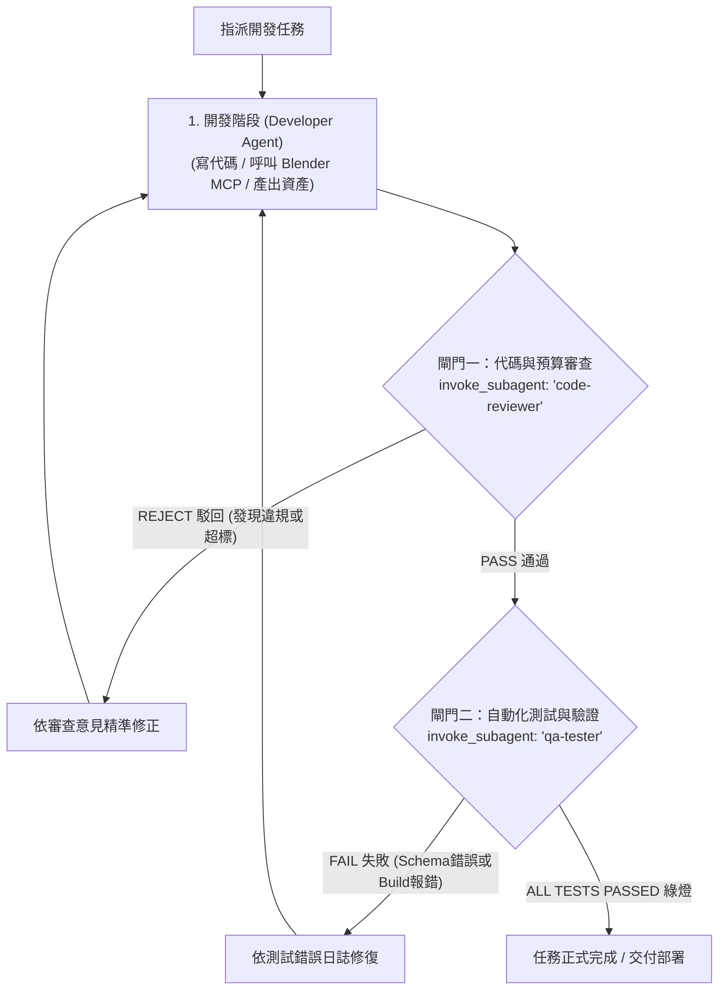

# AGENTS.md — 國小五年級自然 3D 教育遊戲最高協作規範

本規範為參與「國小五年級上學期自然科學（翰林版第一單元：太陽的秘密）」3D 網頁遊戲開發的所有 AI Agents、開發者、自動化子代理（Subagents）與 MCP 服務之最高準則。所有代碼產出、資產生成與架構設計必須 100% 嚴格遵守本規範。

---

## 1. 專案核心使命與極致硬體預算紅線

本專案專為公立國小「生生用平板 / 行動學習」教學現場量身打造，必須在低階終端與擁擠校園 Wi-Fi 環境中以 60 FPS 零卡頓運作，純靜態託管於 GitHub Pages。

### 1.1 目標設備基準
- **低階終端**：Intel Celeron N4000/N4020, 4GB LPDDR4 RAM, Intel UHD Graphics 600 (Chromebook)。
- **行動載具**：iPad (第 8-10 代), WebKit/Safari 瀏覽器，高 DPR Retina 螢幕。
- **網路條件**：單一無線 AP 承載 30 部設備，瞬時頻寬低於 100 Mbps。

### 1.2 嚴格效能預算（Violations will block CI/CD）
| 監控維度 | 嚴格預算上限 | 警戒臨界點 | 稽核與約束手段 |
| :--- | :--- | :--- | :--- |
| **首屏總下載體積** | **< 3.5 MB (Gzip < 1.0 MB)** | 4.5 MB | Vite 建置打包體積檢驗腳本 |
| **每幀繪圖呼叫 (Draw Calls)** | **< 60 次** | 80 次 | `renderer.info.render.calls` 強制監控 |
| **可見三角面數 (Triangles)** | **< 20,000 面** | 25,000 面 | `renderer.info.render.triangles` |
| **即時動態光源** | **0 盞（嚴禁動態陰影）** | 1 盞無陰影環境光 | 程序化扁平幾何陰影（免 ShadowMap） |
| **唯一材質球數量** | **< 6 組** | 8 組 | 全場景共用單張 256×256 調色盤圖集 |
| **裝置像素比 (DPR)** | **強制 `Math.min(window.devicePixelRatio, 1.5)`** | 1.5 | 避免 iPadOS 顯存耗盡觸發 Context Lost |
| **文字與題庫渲染** | **100% Tailwind CSS DOM 覆蓋層** | - | 嚴禁在 WebGL Canvas 動態繪製中文 TextMesh |

---

## 2. 教學領域核心邏輯：翰林五上自然「太陽的秘密」

遊戲非單純答題測驗，而是將不可見的光路幾何化，落實「預測—觀察—解釋」（POE）探究閉環，破除學童四大深固迷思：

### 2.1 核心科學概念矩陣
1. **地平座標系雙要素**：平面十六方位（0°~360°）與垂直高度角（0° 至 90°）。
2. **光影幾何反比模型**：$\tan\theta = \frac{h}{L}$。高度角 $\theta$ 愈高，影長 $L$ 愈短；正午高度角最高、影長最短。
3. **180° 背向鏡像規則**：影子落點與太陽方位呈 180° 相反對稱（光源、竿頂、影端三點共線）。
4. **臺灣在地觀測事實**：以嘉義北回歸線（北緯 23.5°）為準，正午太陽「全年偏南方天空」（夏至除外），冬至正午高度角僅約 43°，影子長且指向正北。
5. **四季與入射能量通量**：輻射通量 $E = E_0 \cdot \sin\theta$。直射吸熱多、斜射吸熱少。

### 2.2 四大迷思破除與 3D 空間核心玩法對應
| 迷思概念 | 學童致命直覺錯誤 | 3D 遊戲核心交互機制 (Gameplay Mechanics) |
| :--- | :--- | :--- |
| **1. 方位同向謬誤** | 看到影子在西北，直覺以為太陽在西北 | **【逆光雷射盲盒關】**：大霧遮蔽天空，地面僅有指向西北的標竿長影。學童操控探測車轉動雷射砲，瞄準相反 180° 東南方天空射擊，命中隱藏太陽解鎖迷霧，點亮三點共線金光。 |
| **2. 高度角正比謬誤** | 以為中午太陽最高最大，影子一定最長 | **【日輪滑軌縮影機】**：提供垂直滑軌讓學童拉動太陽高度角（10° $\rightarrow$ 85°），即時看見地面影子如同彈簧般收縮，將影子精準縮進光圈解鎖大門。 |
| **3. 正午必在天頂 (90°)** | 深信成語「日正當中」，中午太陽必在正頭頂 | **【冬至正午立竿解謎】**：設定為臺灣冬至正午 12:00。旗桿出現顯著偏北長影，引導學童調轉相機至南方天空（高度角 43°）定位太陽，破除文化語義偏見。 |
| **4. 量角器基線錯誤** | 量角器圓心掛竿頂，或基線朝天空懸空 | **【3D 磁吸量角器拉線】**：3D 半圓量角器模型，圓心必須吸附於「地表影端點」，底線水平緊貼地面，自竿頂拉線測量入射角。放錯竿頂立即亮紅燈提示。 |
| **整合關：四季追日** | 不理解太陽能發電與季節冷暖原理 | **【向日葵雙軸追日面板】**：微控制器雙軸感光面板，手動或自動轉向光源，直射時感光風扇全速運轉，直觀體驗能量通量。 |

---

## 3. 系統整體架構與模組拓撲

```text
D:\國小課程遊戲\五上自然\
├── .agents/
│   └── skills/
│       ├── edtech-3d-asset-builder/   # Blender MCP 低面數 (<500面) 3D 模型生成規範
│       └── edtech-ui-illustrator/     # Antigravity 生圖工具 2D UI/封面/勳章生成規範
├── .github/
│   └── workflows/
│       └── deploy.yml                 # CI/CD: 題庫 Schema 驗證 + Vite 打包 + Pages 發布
├── public/
│   ├── assets/
│   │   ├── models/                    # Draco 壓縮 GLB (gnomon, rover, compass, < 1.5MB)
│   │   └── ui/                        # 關卡封面卡、成就徽章 (WebP, < 30KB/張)
│   ├── palettes/
│   │   └── palette.png                # 256x256 全場景共用色塊圖集 (2.0 KB)
│   ├── draco/                         # Draco WASM 解碼器靜態檔
│   ├── favicon.ico
│   ├── icon-192.png
│   └── icon-512.png
├── src/
│   ├── core/
│   │   ├── Engine.js                  # Three.js 核心 (DPR<=1.5, 零 GC 迴圈, ContextLost 防禦)
│   │   ├── EventBus.js                # 3D 引擎與 DOM UI 單向解耦事件匯流排
│   │   ├── AssetManager.js            # GLTF/Draco 異步快取管理器 + 著色器預編譯
│   │   ├── AudioManager.js            # Web Audio API 合成音效 (零音效檔體積, iOS 解鎖)
│   │   └── InputManager.js            # 雙軸歸一化向量 (WASD 鍵盤 / 觸控自適應虛擬搖桿)
│   ├── entities/
│   │   ├── Gnomon.js                  # 觀測標竿 + 程序化扁平幾何陰影 (免 ShadowMap)
│   │   ├── SolarRig.js                # 太陽天球軌跡光球與平行光路引導體
│   │   ├── Protractor3D.js            # 3D 空間量角器與動態繃緊拉線幾何
│   │   └── Rover.js                   # 學童探測車載具 (AABB 碰撞檢測、等角相機跟隨)
│   ├── game/
│   │   ├── GameState.js               # 遊戲狀態機 (Exploring, Predicting, Measuring, Cleared)
│   │   ├── SunPathMath.js             # 北回歸線天體幾何 (二分二至點時角/方位/高度角轉換)
│   │   └── ProgressManager.js         # COPPA 相容 32-bit Bitmask 進度碼 (8 碼 Base64URL)
│   ├── ui/
│   │   ├── CompassHUD.js              # 十六方位羅盤與即時高度角電子儀表板 (DOM)
│   │   ├── VirtualJoystick.js         # 觸控動態浮動虛擬搖桿 (DOM)
│   │   └── QuizOverlay.js             # POE 鷹架探究題目視窗與回饋卡 (DOM)
│   ├── data/
│   │   └── questions.json             # 翰林五上自然 4 大迷思專屬題庫
│   ├── main.js                        # 應用入口與場景路由器
│   └── style.css                      # Tailwind CSS 全域樣式
├── index.html                         # 主頁骨架 (Canvas 與 DOM 覆蓋容器)
├── package.json
├── questions.schema.json              # 題庫 JSON Schema 驗證規格
├── vite.config.js                     # base: './', PWA CacheFirst 快取策略
├── DEVELOPMENT_PLAN.md                # 端到端開發時程與里程碑
└── AGENTS.md                          # 本協作規範
```

---

## 4. MCP 工具鏈與專屬 Skills 分工指引

在多 Agent 或子代理協同作業時，必須明確調用以下 MCP 與 Skills：

### 4.1 3D 資產建構代理 (`@asset-builder`)
- **專屬 Skill**：[`.agents/skills/edtech-3d-asset-builder/SKILL.md`](file:///D:/國小課程遊戲/五上自然/.agents/skills/edtech-3d-asset-builder/SKILL.md)
- **工具鏈**：Blender MCP (`execute_blender_code`, `get_scene_info`, `look`)
- **強制規範**：
  - 柱體限制 $8 \sim 12$ 邊形、球體限制 $12 \times 8$、單物件面數強制 $< 500$ 面。
  - 所有面 UV 強制坍塌映射至 `public/palettes/palette.png`。
  - 輸出前執行面數稽核，一鍵導出至 `public/assets/models/<name>.glb`。
  - 呼叫 `look` 回傳視口截圖供視覺檢驗。

### 4.2 2D UI 插畫代理 (`@ui-illustrator`)
- **專屬 Skill**：[`.agents/skills/edtech-ui-illustrator/SKILL.md`](file:///D:/國小課程遊戲/五上自然/.agents/skills/edtech-ui-illustrator/SKILL.md)
- **工具鏈**：Antigravity 原生 `image-generator`
- **強制規範**：
  - 鎖定「純淨扁平向量插畫」、粗線條、圓角幾何。
  - 畫面 100% 嚴禁生成任何字母、數字、浮水印或亂碼。
  - 色系強制對齊調色盤（日輪黃、天體藍、地表綠）。
  - 保存為 `.webp` 格式，單張檔案體積強制 $< 30\text{ KB}$。

### 4.3 靜態管線與部署代理 (`@devops`)
- **工具鏈**：GitHub MCP (`C:\Users\Terry\.gemini\bin\github-mcp-server.exe`)
- **強制規範**：
  - 執行 `ajv test -s questions.schema.json -d "src/data/*.json" --valid` 確保題庫零語意錯誤。
  - 配置 `vite.config.js` 之 `base: './'`，確保 GitHub Pages 子路徑資產永不 404。
  - 自動維護 `.github/workflows/deploy.yml` 實現 GitHub Actions 自動編譯與發布。

### 4.4 核心渲染與物理架構代理 (`@engine`)
- **專責代碼**：`src/core/`, `src/entities/`, `src/game/`
- **強制規範**：
  - 實作 iOS Safari WebGL 上下文遺失與恢復生命週期防禦。
  - 渲染迴圈 `requestAnimationFrame` 內部**嚴禁動態配置物件**，必須使用模組級靜態記憶體暫存器。
  - 標竿陰影採用程序化幾何縮放平移網格，徹底停用 Three.js `castShadow`。

---

## 5. COPPA 兒童隱私合規與無狀態進度機制

為徹底符合美國 COPPA 與校園零個資外洩原則：
1. **嚴禁後端伺服器與學生帳號系統**。
2. **Bitmask 狀態壓縮架構**：
   - 每個關卡以 3 個 bit 表示：`bit 2`（解鎖狀態 0/1）、`bit 0-1`（星級 0~3 星）。
   - 10 個關卡共佔 30 bits，可壓縮進單一 32-bit 整數。
   - 附加 8-bit CRC 校驗碼，總計 40 bits。
3. **字串格式**：以 8 碼十六進位轉為易讀代碼（如 `SUN-7A9B-4F`）。學童換機時於 UI 輸入代碼或掃描 QR Code 即可還原進度。

---

## 6. 程式碼撰寫鐵律與 Anti-Patterns（嚴禁觸犯）

1. **嚴禁引入 React / Vue / Angular**：本專案採用純原生 Vanilla JS + Vite。嚴禁引入 Virtual DOM 框架造成 Celeron CPU 垃圾回收卡頓。
2. **嚴禁啟用 `castShadow` 與 `receiveShadow`**：標竿陰影必須使用程序化扁平幾何網格，以維持 Draw Calls < 60。
3. **嚴禁在 WebGL Canvas 動態繪製中文字**：所有題庫文字與提示必須由 Tailwind CSS DOM 覆蓋層渲染。
4. **嚴禁外部 CDN 未授權字體或 API 呼叫**：所有資產必須在本地靜態化打包，杜絕外部網路中斷風險。
5. **嚴禁在渲染迴圈 `requestAnimationFrame` 中分配物件**：
   - ❌ `function tick() { const v = new THREE.Vector3(); ... }`
   - ✅ 模組級變數複用：`const _tempVec = new THREE.Vector3(); function tick() { _tempVec.set(...); }`

---

## 7. 三階段子代理閘門工作流（開發 $\rightarrow$ 審查 $\rightarrow$ 測試）

本專案所有功能特徵（Features）、資產生成或代碼修訂，必須嚴格恪遵「**開發 (Develop) $\rightarrow$ 審查 (Review) $\rightarrow$ 測試 (Test)**」三階防禦閘門。任何任務未獲 Reviewer 簽可與 Tester 綠燈前，嚴禁合併或判定為完成。



### 7.1 第一階段：開發代理（Developer Agent）
- **職責**：依據功能規格編寫代碼、撰寫單元測試、調用 Blender MCP 建立低面數模型或生成 2D WebP 圖示。
- **產出**：具體代碼檔案與資產，並於交接時陳述變更範圍與對標之 AGENTS.md 規範。

### 7.2 第二階段：審查子代理（`code-reviewer` Subagent）
- **工具權限**：**唯讀沙盒（EnableWriteTools: false）**，嚴禁球員兼裁判。
- **觸發方式**：由主流程調用 `invoke_subagent(TypeName='code-reviewer', Role='Code & Budget Reviewer')`。
- **7 大強制稽核清單**：
  1. `requestAnimationFrame` 迴圈內是否零 GC 物件配置？
  2. 是否完全停用 `castShadow`、零動態光源，標竿陰影是否為純幾何網格？
  3. `renderer.setPixelRatio` 是否強制封頂至 1.5？
  4. 是否完全無 Canvas 中文字，100% 透過 Tailwind DOM 覆蓋層渲染？
  5. 3D 模型面數是否 $< 500$ 面，UV 是否坍塌至 `palette.png`？
  6. 太陽光影天體幾何是否符合 180° 鏡像對稱與冬至正午 43° 長影偏北事實？
  7. 是否符合 COPPA 零後端、零個資、Bitmask 規範？
- **閘門決策**：必須輸出 `【PASS 通過】` 或 `【REJECT 駁回】`。若 REJECT，必須指出檔案、行號與修訂代碼。

### 7.3 第三階段：測試子代理（`qa-tester` Subagent）
- **工具權限**：具備指令執行權（`run_command`），無 MCP/子代理調度權。
- **觸發方式**：通過審查後調用 `invoke_subagent(TypeName='qa-tester', Role='Automated QA Tester')`。
- **強制執行檢驗鏈**：
  1. **題庫校驗**：`npx ajv test -s questions.schema.json -d "src/data/*.json" --valid`
  2. **靜態建置**：`npm run build` 確認打包零警告、零路徑引用錯誤。
  3. **體積稽核**：檢查 `dist/` 總大小 $< 3.5\text{ MB}$（Gzip $< 1.0\text{ MB}$）。
  4. **相對路徑檢驗**：確認 `index.html` 之資源路徑均為 `./`，杜絕 GitHub Pages 404。
  5. **演算法驗證**：執行 `SunPathMath` 與 `ProgressManager` CRC 校驗測試。
- **閘門決策**：必須輸出 `【ALL TESTS PASSED】`。若失敗則產出錯誤日誌截圖退回開發階段。

