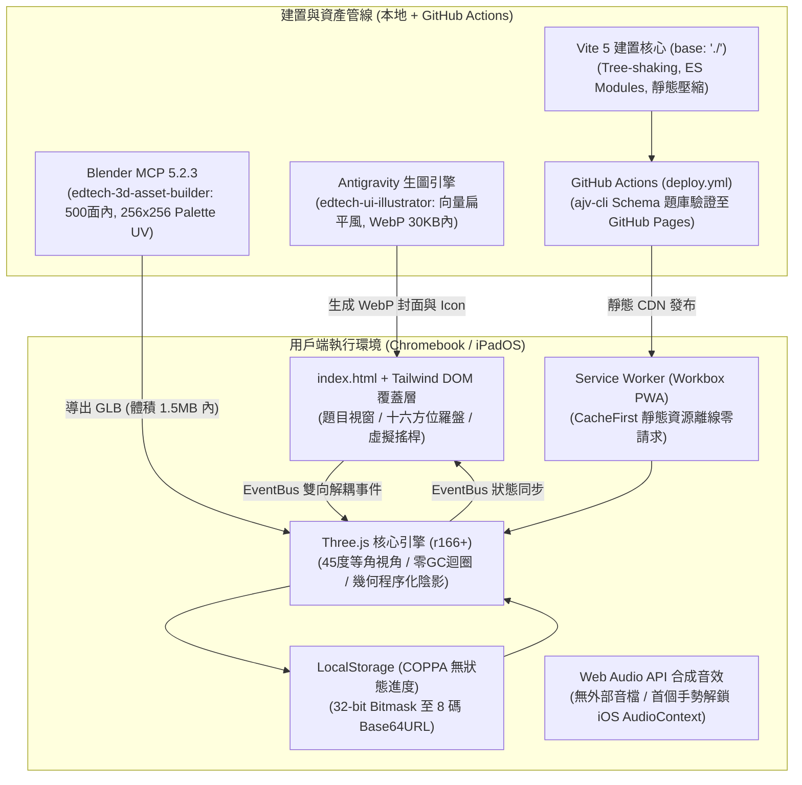

# 國小五上自然 3D 教育遊戲（太陽的秘密）端到端開發計畫書

本計畫書依據教育部 108 課綱自然科學領域、翰林版國小五年級上學期第一單元「太陽的秘密」，結合《基於 GitHub Pages 靜態託管環境之國小輕量化 3D 教育遊戲架構》制定。本文件為全流程工程落地、資產建置與 CI/CD 發布之最高實施藍圖。

---

## 1. 專案核心定位與架構決策

### 1.1 系統架構拓撲圖

### 1.2 模組層次與通訊職責表

| 系統分層 | 核心技術與模組 | 職責與通訊機制 |
| :--- | :--- | :--- |
| **3D 空間核心層** | Vanilla Three.js (`Engine.js`, `Gnomon.js`, `Rover.js`) | 60 FPS 渲染迴圈、45° 等角視角、程序化幾何陰影（免動態影）、零 GC 記憶體池。 |
| **2D UI 覆蓋層** | Tailwind CSS DOM (`CompassHUD.js`, `QuizOverlay.js`, `VirtualJoystick.js`) | 十六方位羅盤儀表、POE 鷹架題目視窗、自適應觸控搖桿。**透過 EventBus 與 3D 引擎單向解耦。** |
| **離線快取防線** | Service Worker (`vite-plugin-pwa`, Workbox) | `CacheFirst` 靜態快取策略，全班 30 台設備離線可用、杜絕 AP 頻寬崩潰。 |
| **無狀態進度保存** | 本地 Web Storage (`ProgressManager.js`) | 32-bit Bitmask 狀態壓縮 + 8-bit CRC，轉為 8 碼字串（如 `SUN-7A9B-4F`），零個資合規。 |
| **3D 資產自動化** | Blender MCP (`edtech-3d-asset-builder`) | 500 面以下極低面數幾何、單張 256×256 調色盤圖集單點 UV 映射。 |
| **2D 視覺自動化** | Antigravity 生圖 (`edtech-ui-illustrator`) | 扁平向量插畫、PWA Icon、關卡封面與 POE 迷思解說卡（WebP $< 30\text{ KB}$）。 |
| **CI/CD 自動發布** | GitHub Actions (`deploy.yml`) + GitHub MCP | 自動執行 `ajv` 題庫驗證、Vite 靜態打包並推送至 GitHub Pages CDN。 |

---

## 2. 核心硬體預算紅線與防禦指標

| 評估指標 | 嚴格預算上限 | 警戒臨界點 | 執行規範與防禦策略 |
| :--- | :--- | :--- | :--- |
| **首屏總下載量** | **< 3.5 MB (Gzip < 1.0 MB)** | 4.5 MB | 嚴禁第三方肥大字庫與非必要庫，全部資產在地化靜態打包 |
| **每幀繪圖呼叫 (Draw Calls)** | **< 60 次** | 80 次 | 全場景模型共用單張 256×256 色塊圖集 (`palette.png`)，單一材質球 |
| **可見三角面數 (Triangles)** | **< 20,000 面** | 25,000 面 | 道具模型 $< 500$ 面，探測車 $< 800$ 面，柱體限制 $8 \sim 12$ 邊形 |
| **即時動態光源** | **0 盞（嚴禁動態陰影）** | 1 盞無陰影環境光 | 標竿陰影採用幾何程序化壓平網格（$\tan\theta = h/L$ 矩陣縮放） |
| **裝置像素比 (DPR)** | **強制限制 $\le 1.5$** | 1.5 | `Math.min(window.devicePixelRatio, 1.5)` 防止 iPad Retina 顯存耗盡 |
| **音訊資源體積** | **0 KB**（純代碼合成） | 100 KB | 使用 Web Audio API `OscillatorNode` 即時合成按鈕與通關音效 |

---

## 3. 四大關卡遊戲化探究機制 (POE 閉環)

| 關卡編號與名稱 | 破除迷思目標 | 3D 空間核心交互與通關條件 |
| :--- | :--- | :--- |
| **Stage 1: 逆光雷射盲盒** | **方位同向謬誤** （以為影子在西北，太陽就在西北） | 操場起大霧遮蔽天空，地面僅有指向西北的吸管長影。 學童操控探測車轉動雷射砲，**瞄準相反 180° 東南方天空射擊**。 命中太陽光球後大霧消散，三點共線金光射線貫穿天空與地面。 |
| **Stage 2: 日輪滑軌縮影機** | **高度角正比謬誤** （以為中午太陽高影子就最長） | 畫面提供垂直高度角滑軌（10° $\rightarrow$ 85°）。 學童滑動抬升太陽時，**目睹地面影子像彈簧一樣迅速縮短**。 將影子長度精準收縮進地表目標光圈（如 $L=2.1\text{cm}$）解鎖大門。 |
| **Stage 3: 冬至正午立竿解謎** | **正午必在正天頂 (90°)** （深信日正當中中午無影） | 場景設定在臺灣冬至正午 12:00。 學童原本以為沒有影子，走近卻發現旗桿拖著一條**筆直指向正北的長影**。 調動視角至南方天空（高度角 43°）定位太陽，破除成語誤導。 |
| **Stage 4: 3D 磁吸量角器拉線** | **量角器放置基線錯誤** （量角器圓心掛竿頂或懸空） | 3D 空間半圓量角器。 學童必須將量角器**圓心拖曳吸附於地表影子末端，底線水平平貼地面**。 自竿頂拉下一條繃緊光束細線，對齊刻度讀取高度角度數。 |
| **Bonus: 追日向日葵雙軸面板** | **四季冷暖與光通量關聯** （輻射能量通量 $E = E_0 \cdot \sin\theta$） | 操作雙軸微控制器追日面板。 手動旋轉或開啟演算法自動追日，直射時感光風扇轉速拉滿，直觀體驗直射斜射吸熱差異。 |

---

## 4. 詳細開發階段與任務拆解 (Phase 1 ~ Phase 5)

### 【Phase 1: 專案基建與渲染核心】
- [ ] **1.1 專案結構與相依配置**：初始化 `package.json`、`vite.config.js`（`base: './'`）、`tailwind.config.js`、`index.html`。
- [ ] **1.2 Three.js 核心引擎 (`Engine.js`)**：
  - 強制 DPR 上限 1.5。
  - 固定 45 度俯視等角 PerspectiveCamera。
  - 模組層級靜態暫存器池（零 GC 記憶體分配迴圈）。
  - iOS Safari WebGL 上下文遺失與恢復生命週期防護。
- [ ] **1.3 解耦事件匯流排 (`EventBus.js`)**：
  - 純原生 Pub/Sub 模式，徹底隔離 Three.js 空間運算與 Tailwind DOM 視窗。
- [ ] **1.4 雙模輸入控制器 (`InputManager.js`)**：
  - 鍵盤（WASD / 方向鍵）二維歸一化。
  - 觸控螢幕自適應動態浮動虛擬搖桿（支援多點觸控，實體鍵盤操作時自動淡出）。

### 【Phase 2: 天體物理與光影幾何運算模組】
- [ ] **2.1 北回歸線天體幾何算式 (`SunPathMath.js`)**：
  - 實作嘉義北回歸線基準（北緯 23.5°）二分二至點時角計算公式：
    $$\sin\alpha = \sin\phi \sin\delta + \cos\phi \cos\delta \cos H$$
  - 提供 `calculatePosition(season, hour)` 輸出精確度數。
- [ ] **2.2 程序化扁平幾何陰影標竿 (`Gnomon.js`)**：
  - 標竿吸管實體幾何。
  - 依據 $\tan\theta = h/L$ 實作純幾何縮放平移陰影（**徹底停用 Three.js ShadowMap**）。
  - 180° 鏡像對稱方位動態旋轉。
- [ ] **2.3 3D 仰角量角器與拉線幾何 (`Protractor3D.js`)**：
  - 3D 半圓量角器幾何刻度。
  - 竿頂至影端繃緊拉線（動態 Line2 / TubeGeometry）。
  - 吸附判定邏輯（竿頂誤放警示、影端貼合檢驗、底線地平夾角檢驗）。

### 【Phase 3: 雙軌資產生成與管線自動化】
- [ ] **3.1 3D 模型資產管線 (調用 `edtech-3d-asset-builder`)**：
  - 調用 Blender MCP 生成：
    - `gnomon_stand.glb`（標竿底座＋水平氣泡儀，$< 350$ 面）
    - `compass_dial.glb`（十六方位地平圓盤，$< 300$ 面）
    - `solar_rover.glb`（學童探測車載具，$< 700$ 面）
    - `solar_tracker.glb`（雙軸追日面板＋風扇，$< 450$ 面）
  - 全數 UV 坍塌對齊已生成之 [`palette.png`](file:///D:/國小課程遊戲/五上自然/public/palettes/palette.png)。
  - 呼叫 `look` 工具進行視口品質截圖確認。
- [ ] **3.2 2D UI 插畫資產管線 (調用 `edtech-ui-illustrator`)**：
  - 調用 Antigravity 原生生圖生成：
    - PWA App Icon（512×512，日輪黃＋探測車風格）
    - 4 大關卡 16:9 封面卡片（`stage-01` ~ `stage-04`，WebP $< 30\text{ KB}$）
    - 3 枚榮譽成就徽章（透明背景 WebP）
- [ ] **3.3 資產快取管理器 (`AssetManager.js`)**：
  - 整合 GLTFLoader 與 Draco WASM 解碼器。
  - 場景切換前執行 `renderer.compileAsync` 著色器預編譯，消除初次著色卡死。

### 【Phase 4: POE 關卡狀態機與 DOM 覆蓋層】
- [ ] **4.1 題庫規格定義與實作**：
  - 建立 `questions.schema.json`（嚴格驗證規格）。
  - 編寫專屬題庫 `src/data/questions.json`（4 大迷思對應題型）。
- [ ] **4.2 POE 鷹架題目視窗 (`QuizOverlay.js`)**：
  - 預測階段設問 $\rightarrow$ 3D 空間操作 $\rightarrow$ 數據比對與科學解釋卡片。
- [ ] **4.3 即時儀表板 HUD (`CompassHUD.js`)**：
  - 動態十六方位指北針羅盤。
  - 即時高度角（0°~90°）與時間日晷刻度。
- [ ] **4.4 COPPA 無狀態進度管理 (`ProgressManager.js`)**：
  - 10 關卡 32-bit Bitmask 編解碼器與 CRC8 校驗。
  - 8 碼換機通關代碼生成與解析（如 `SUN-7A9B-4F`）。
- [ ] **4.5 Web Audio 合成音效 (`AudioManager.js`)**：
  - 零音效檔案體積，使用 Web Audio API 合成按鈕點擊音、雷射命中音與通關和弦。
  - 首個觸控手勢解鎖 iOS AudioContext。

### 【Phase 5: GitHub Pages 自動部署與實機驗收】
- [ ] **5.1 PWA 離線快取配置 (`vite-plugin-pwa`)**：
  - Workbox CacheFirst 快取策略，快取 HTML/JS/CSS/GLB/WASM/WebP，實現完全離線可用。
- [ ] **5.2 CI/CD 自動化管線 (`.github/workflows/deploy.yml`)**：
  - GitHub Actions 整合 `ajv-cli` 題庫自動校驗。
  - Vite 打包產物自動推送至 `gh-pages` 分支。
- [ ] **5.3 低規硬體實機測試驗收**：
  - Chromebook（Celeron N4020）全流程 60 FPS 穩定度驗收。
  - iPadOS Safari 15 分鐘長時間遊玩顯存壓力測試（零 Context Lost）。

---

## 5. 驗收標準與效能稽核清單 (Done Criteria)

- [ ] **體積驗收**：`dist/` 打包產物總容量 $< 3.5\text{ MB}$（Gzip 後 $< 1.0\text{ MB}$）。
- [ ] **繪圖效率**：全遊戲進行時 `Draw Calls <= 60`、`Triangles <= 20,000`。
- [ ] **並發載入**：單一無線 AP 承載 30 台平板，首次載入時間 $< 8\text{ 秒}$，二次快取載入 $< 1.5\text{ 秒}$。
- [ ] **課綱吻合**：二分二至點高度角運算完全吻合教育部審定本（冬至正午 43°、夏至 90°、春秋分 66.5°）。
- [ ] **隱私法規**：全流程無任何後端伺服器請求、零個人身分識別資訊（PII）收集，符合美國 COPPA 標準。

---

## 6. 子代理執行管制規章（開發 $\rightarrow$ 審查 $\rightarrow$ 測試工作流）

專案中每一項里程碑任務（如 T1.2, T2.1, T3.1 等），在標註為完成前必須依序通過以下三道子代理閘門：

1. **【開發執行（Developer）】**：
   - 負責人：主代理或調度特定開發任務子代理。
   - 輸出：實體程式碼、設定檔或經 Blender MCP / 生圖工具導出之資產。
2. **【架構審查（`code-reviewer` Subagent）】**：
   - 調度：`invoke_subagent(TypeName='code-reviewer', Role='Code Reviewer')`
   - 審查標準：唯讀沙盒檢核，7 項預算紅線（零 GC、無動態影、DPR $\le 1.5$、無 Canvas 中文字、面數 $< 500$、天體物理幾何 180° 對稱、COPPA Bitmask）。
   - 門檻：必須獲評 `【PASS 通過】`，若駁回則返回開發修正。
3. **【自動化測試（`qa-tester` Subagent）】**：
   - 調度：`invoke_subagent(TypeName='qa-tester', Role='QA Tester')`
   - 執行命令：`ajv` Schema 檢驗、`npm run build` 打包、`dist/` 體積與相對路徑審查。
   - 門檻：必須獲評 `【ALL TESTS PASSED】` 綠燈，方可提交版本變更。

