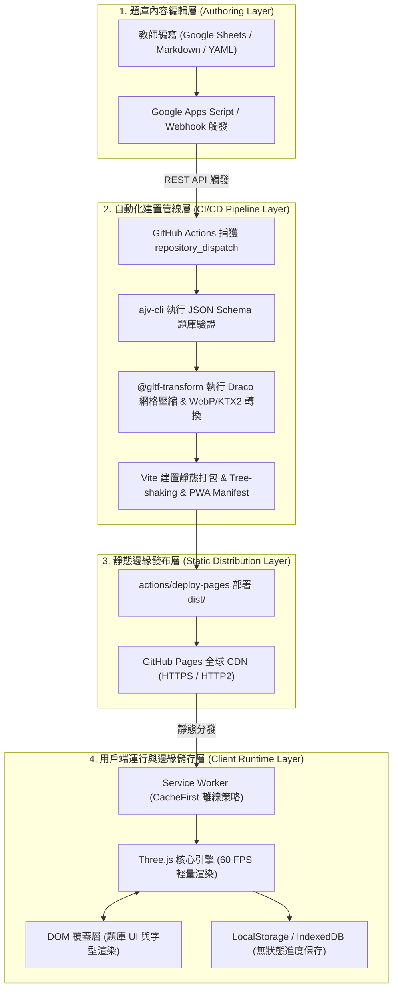

# 基於 GitHub Pages 靜態託管環境之國小跨學科輕量化 3D 教育遊戲架構設計與工程落地評估

## 技術選型決策矩陣與效能基準調研

在推動校園數位學習的實務現場，終端硬體配備普遍受限於採購預算與設備更新週期。目前多數公立國小生生用平板與行動學習載具，主要以教育採購規格的入門款 Chromebook（搭載雙核心 Intel Celeron N4000/N4020 處理器、Intel UHD Graphics 600 內建顯示晶片、4GB LPDDR4 記憶體）以及基礎款 Apple iPad（第 8 至 10 代，基於 WebKit 架構的 Safari 瀏覽器）為骨幹。

此類設備的共性為中央處理器單核效能有限、繪圖執行單元（Execution Units）僅 12 至 18 組，且顯示記憶體高度依賴主系統記憶體的動態劃分。在班級 Wi-Fi 網路架構中，單一無線存取點（Access Point, AP）常需承載 30 部設備同時連線，瞬時下行頻寬可能跌破 100 Mbps，使得龐大的執行檔體積與未經最佳化的圖形管線成為網頁遊戲落地的主要障礙。評估目前主流的 Web 3D 技術棧，必須在運行效能、記憶體佔用、初始下載容量以及與純靜態託管（GitHub Pages）的相容性之間取得平衡。

### 渲染引擎多維度決策矩陣

| 評估維度 | Three.js (Vanilla r166+) | React Three Fiber (R3F) | Babylon.js (v7+) | PlayCanvas (Engine 2.x) | Godot 4.x (HTML5/WASM) |
| :--- | :--- | :--- | :--- | :--- | :--- |
| **首屏核心體積 (Gzip)** | ~150 – 185 KB | ~220 – 260 KB (含 React) | ~1.0 – 2.8 MB (含 Havok) | ~1.2 – 1.8 MB | ~9.0 – 30.0 MB (.pck + wasm) |
| **靜態運行記憶體峰值 (RAM)** | ~45 – 80 MB | ~75 – 120 MB | ~140 – 260 MB | ~90 – 160 MB | ~280 – 500+ MB |
| **Intel UHD 600 繪圖呼叫上限** | 120 – 180 Calls @ 60 FPS | 90 – 130 Calls @ 60 FPS | 100 – 150 Calls @ 60 FPS | 110 – 160 Calls @ 60 FPS | < 60 Calls (常態跌破 30 FPS) |
| **iPad Safari 穩定度** | 極高（無 Context Lost 紀錄） | 高（需注意 VDOM GC 停頓） | 高（需手動調整 DPR） | 極高（專為 Web 最佳化） | 低（記憶體耗盡頻繁崩潰） |
| **GitHub Pages 託管摩擦力** | 零摩擦（純靜態分發） | 零摩擦（純靜態分發） | 零摩擦（純靜態分發） | 零摩擦（開源引擎核心） | 極高（依賴 SharedArrayBuffer 與 COOP/COEP） |
| **非程式背景教師維護難度** | 中（透過宣告式 JSON 解耦） | 中高（需具備 JSX 概念） | 中（API 抽象度高） | 高（依賴專用雲端編輯器） | 中（專用 GUI 但產物整合難） |
| **綜合適用度推薦指數** | **首選推薦 (9.5/10)** | 次選推薦 (8.0/10) | 備選考量 (7.0/10) | 備選考量 (7.5/10) | 不推薦 (3.5/10) |

---

### 引擎架構特性與校園部署可行性深度剖析

1. **Godot 4.x**
   - **底層限制**：Web 導出採用重度多執行緒架構，底層高度依賴 WebAssembly 的 `SharedArrayBuffer` API。出於 Spectre 等硬體安全防護機制，瀏覽器強制要求託管環境必須在 HTTP 標頭提供 `Cross-Origin-Opener-Policy: same-origin` (COOP) 與 `Cross-Origin-Embedder-Policy: require-corp` (COEP)。
   - **託管障礙**：GitHub Pages 純 CDN 託管不支援自訂 HTTP 標頭。雖然可藉由 Service Worker（如 `coi-serviceworker`）攔截注入，但在 iPadOS Safari 或受限校園網路常出現初次載入黑屏、非同步 WASM 初始化失敗及二次刷新中斷。
   - **容量與記憶體負擔**：最小化 WASM 核心與資源包（`.pck`）Gzip 後達 9 MB 以上，解壓後靜態記憶體需求超越 280 MB，在 4GB RAM Chromebook 上極易觸發 OOM 分頁崩潰。

2. **Babylon.js**
   - **優點與短板**：開箱即用功能最完整，內建 Havok 物理引擎、進階 GUI 與成熟粒子系統。
   - **網路負載**：全量核心加物理引擎打包初始網路 Payload 近 3 MB，全班 30 部終端冷啟動時易造成無線 AP 佇列壅塞。

3. **Vanilla Three.js (首選)**
   - **優勢**：核心庫 Gzip 僅約 150 ~ 185 KB，允許精準控制 WebGL/WebGPU 狀態機與記憶體生命週期。
   - **對比 R3F**：React Three Fiber 的 React Virtual DOM 比較（Reconciliation）在高頻渲染下會產生頻繁物件配置，在 Celeron 雙核 CPU 上容易引發明顯的垃圾回收（GC Pauses）微卡頓。原生 Three.js 配合模組化架構能確保在低階校園終端穩固跑在 60 FPS。

---

### 靜態託管容量與頻寬防線測算

GitHub Pages 規範與配額邊界：
- 單一儲存庫上限：1 GB
- 單一二進位檔案上限：100 MB
- 每月軟性頻寬限制：100 GB

**情境估算基準**：
- 編制 24 班中型國小，三至六年級共 16 班約 450 名學童。
- 設定每週 1 次跨學科 3D 複習遊戲，全月總遊玩人次約 1,800 – 2,000 次。
- 單專案資產（代碼、WASM 解碼器、字型、Low-Poly 模型、音效）控制在 3.5 MB 以內。

$$\text{月頻寬消耗} = 2,000 \times 3.5\text{ MB} = 7,000\text{ MB} \approx 6.84\text{ GB}$$

- **結論**：僅佔 GitHub Pages 100 GB 配額的 **6.84%**，具備極高餘裕。
- **對照**：Godot 4 方案初次載入約 35 MB，單月頻寬直逼 70 GB，一旦多校推廣或重試載入極易面臨分發中斷封鎖。

---

## 系統拓撲與資料流架構設計

為實現「完全解耦的非技術人員維護管線」與「免伺服器運作的安全架構」，系統架構劃分為四個層級：



### 系統資料流階段對照

| 階段名稱 | 核心處理單元 | 輸入資產與資料 | 輸出資產與傳輸協議 | 效能與安全性保障措施 |
| :--- | :--- | :--- | :--- | :--- |
| **內容編輯** | Google Sheets / 本機編輯器 | 教師編寫之跨學科題目 | 結構化 CSV / YAML / JSON | 欄位防呆限制、無程式碼介面 |
| **自動化建置** | GitHub Actions 虛擬主機 | 原始 3D 模型與題庫資料 | 最佳化 GLB、靜態 HTML/JS/CSS | JSON Schema 校驗、Draco/KTX2 壓縮 |
| **邊緣發布** | GitHub Pages CDN 節點 | Vite 編譯完成之 `dist/` | HTTPS 靜態檔案響應 (HTTP/2) | 全球 CDN 邊緣快取、Brotli 自動壓縮 |
| **用戶端載入** | Service Worker (Workbox) | 靜態網路請求 | 快取命中資產 (Cache Storage API) | 零網路二次載入、斷網可用支援 |
| **場景渲染** | Three.js WebGL Engine | 壓縮後 3D 資產與題庫 | 60 FPS 畫布、3D 空間互動邏輯 | 頂點光照烘焙、批次合併繪製呼叫 |
| **狀態持久化** | 本機 Web Storage 引擎 | 學童答題回饋、成就徽章 | LocalStorage 加密代碼 / IndexedDB | 零個資收集（符合 COPPA 法規） |

---

## COPPA 兒童隱私合規與免登入跨裝置進度機制

美國兒童線上隱私保護法（COPPA）嚴禁在未取得家長同意前收集 13 歲以下學童之個人身分識別資訊（PII）。
- **完全零後端依賴**：無註冊、無伺服器資料庫、無個資蒐集。
- **本機無狀態編碼**：學習進度透過二進位位元遮罩（Bitmask）壓縮通關與星級狀態，附帶 CRC32 校驗碼，轉譯為 8 至 10 碼 Base64URL 易讀代碼（如 `ED-8A9C-F421`）或動態二維碼。
- **換機無縫同步**：學生更換平板或電腦時，直接於前端輸入代碼或掃描 QR Code，離線校驗解碼還原進度。

---

## MVP 端到端落地實作藍圖

### 推薦技術棧組合
- **建置工具**：Vite 5.x
- **圖形渲染核心**：Three.js (r166+) 原生模組
- **解碼擴充**：`three/addons/loaders/GLTFLoader.js` + Draco WASM + KHR_texture_basisu
- **使用者介面**：Tailwind CSS 建構之 DOM 覆蓋層（避免在 WebGL Canvas 繪製複雜字體消耗顯存）
- **離線快取**：`vite-plugin-pwa` (Workbox)

### 專案檔案結構規劃

```text
edtech-3d-review/
├── .github/
│   └── workflows/
│       └── deploy.yml              # GitHub Actions 自動化建置與發布管線
├── public/
│   ├── assets/
│   │   ├── models/                 # 壓縮後之 GLB 模型 (Draco + KTX2)
│   │   ├── textures/               # 共用調色盤圖集
│   │   └── audio/                  # 輕量 Ogg/MP3 音效
│   ├── draco/                      # Draco WASM 解碼器靜態檔案
│   └── favicon.ico
├── src/
│   ├── core/
│   │   ├── Engine.js               # Three.js 渲染器、場景、相機生命週期封裝
│   │   ├── AssetManager.js         # 具備非同步解碼之 GLTF 載入管理器
│   │   └── InputManager.js         # 鍵盤與虛擬搖桿輸入歸一化介面
│   ├── entities/
│   │   ├── Player.js               # 學童角色控制與簡化圓柱體/AABB 碰撞
│   │   └── InteractiveObject.js    # 空間互動題目觸發標的
│   ├── game/
│   │   ├── GameState.js            # 探索、解謎、答題反饋狀態機
│   │   └── ProgressManager.js      # COPPA 相容之本地儲存與代碼匯出
│   ├── ui/
│   │   ├── VirtualJoystick.js      # 觸控螢幕動態虛擬搖桿
│   │   └── QuizModal.js            # 題目 DOM 視窗與即時解析呈現
│   ├── data/
│   │   └── questions.json          # 預設題庫檔案
│   ├── main.js                     # 遊戲入口引導
│   └── style.css                   # Tailwind 全域樣式定義
├── package.json
├── questions.schema.json           # 題庫 JSON Schema 格式規格定義
└── vite.config.js                  # Vite 建置配置與 Workbox PWA 規則
```

### 題庫規格定義 (`questions.schema.json`)

```json
{
  "$schema": "http://json-schema.org/draft-07/schema#",
  "title": "CrossSubjectQuestionBank",
  "type": "object",
  "required": ["version", "subject", "questions"],
  "properties": {
    "version": { "type": "string" },
    "subject": { "type": "string", "enum": ["science", "math", "language"] },
    "gradeLevel": { "type": "integer", "minimum": 1, "maximum": 6 },
    "questions": {
      "type": "array",
      "items": {
        "type": "object",
        "required": [
          "id",
          "type",
          "prompt",
          "spawnPosition",
          "spatialModel",
          "options",
          "correctAnswer",
          "explanation"
        ],
        "properties": {
          "id": { "type": "string" },
          "type": { "type": "string", "enum": ["spatial_choice", "assembly_puzzle", "logic_switch"] },
          "prompt": { "type": "string" },
          "spawnPosition": {
            "type": "object",
            "required": ["x", "y", "z"],
            "properties": {
              "x": { "type": "number" },
              "y": { "type": "number" },
              "z": { "type": "number" }
            }
          },
          "spatialModel": { "type": "string" },
          "options": {
            "type": "array",
            "items": { "type": "string" },
            "minItems": 2,
            "maxItems": 4
          },
          "correctAnswer": { "type": "integer", "minimum": 0, "maximum": 3 },
          "explanation": { "type": "string" }
        }
      }
    }
  }
}
```

### GitHub Actions 自動化管線 (`.github/workflows/deploy.yml`)

```yaml
name: Build and Deploy EdTech 3D Game to GitHub Pages

on:
  push:
    branches: ["main"]
  repository_dispatch:
    types: [question_bank_updated]
  workflow_dispatch:

permissions:
  contents: read
  pages: write
  id-token: write

concurrency:
  group: "pages"
  cancel-in-progress: false

jobs:
  build:
    runs-on: ubuntu-latest
    steps:
      - name: Checkout Source Code
        uses: actions/checkout@v4

      - name: Setup Node.js Runtime
        uses: actions/setup-node@v4
        with:
          node-version: 20
          cache: 'npm'

      - name: Install Dependencies and Tools
        run: |
          npm ci
          npm install -g @gltf-transform/cli ajv-cli

      - name: Validate Question Bank Integrity
        run: |
          ajv test -s questions.schema.json -d "src/data/*.json" --valid

      - name: Optimize and Compress 3D Models
        run: |
          for file in public/assets/models/*.glb; do
            if [ -f "$file" ]; then
              echo "Processing geometry & textures: $file"
              gltf-transform optimize "$file" "$file" \
                --compress draco \
                --texture-compress webp
            fi
          done

      - name: Compile and Bundle via Vite
        run: npm run build

      - name: Upload Pages Artifact
        uses: actions/upload-pages-artifact@v3
        with:
          path: './dist'

  deploy:
    environment:
      name: github-pages
      url: ${{ steps.deployment.outputs.page_url }}
    runs-on: ubuntu-latest
    needs: build
    steps:
      - name: Deploy Artifacts to GitHub Pages CDN
        id: deployment
        uses: actions/deploy-pages@v4
```

---

## 教育遊戲玩法雛形設計

依據皮亞傑（Jean Piaget）認知發展理論，7 至 12 歲學童處於「具體運思期」（Concrete Operational Stage），邏輯推理依賴具體操作與空間視覺表徵。單純彈出 2D 文本試卷會引發注意力分散效應（Split-Attention Effect），三維空間物件本身即為題目的實體化載體。

### 學童操作體驗（Kids UX）與控制抽象層

1. **輸入歸一化介面**：
   - 鍵盤（WASD / 方向鍵）與觸控虛擬搖桿皆抽象映射為二維向量：
     $$(v_x, v_y) \in [-1.0, 1.0]^2$$
   - 觸控裝置動態生成自適應浮動搖桿（直徑 120px，活動半徑 45px）；偵測到實體鍵盤時自動淡出隱藏。
2. **防暈相機控制**：
   - 鎖定固定 45 度俯視的偽等角（Isometric 3/4）跟隨視角，透過彈簧阻尼平滑插值演算法（Spring-Damper Interpolation）跟隨，免除手動旋轉鏡頭，根除 3D 暈眩感。
3. **廣域接近觸發（Proximity Trigger）**：
   - 角色進入物件 2.5 公尺半徑即浮現大型互動圖示，空白鍵或螢幕按鈕即可交互，避免低年級學童點擊射線檢測（Raycasting）之挫折感。

### 三學科玩法方案

#### 方案一：自然科學科 —— 微觀生態系食物網復育（Ecosystem Restorer）
- **教學概念**：食物鏈、生產者、消費者、分解者與能量流動平衡。
- **空間玩法與交互邏輯**：
  - 場景為一座枯黃乾涸的 Low-Poly 浮空島，劃分為三層地貌營養級基座。
  - 學童操作探測車尋找水稻、蝗蟲、青蛙、紅隼等實體模型，以牽引光束搬運至基座。
  - 若將「青蛙」誤置於生產者基座，青蛙彈射退回並提示「青蛙無法行光合作用自製養分」。
  - 排列正確時亮起光粒子能量流，啟動島嶼綠化 Shader 與流水瀑布，強化直觀成就感。

#### 方案二：數學科 —— 空間幾何立方體與展開圖解謎（Polyhedron Architect）
- **教學概念**：正方體、長方體空間透視、表面展開圖及相對面判定。
- **空間玩法與交互邏輯**：
  - 學童身處古代幾何神殿，深崖阻斷通行，需重構展開圖搭橋。
  - 地面有 6 片發光石板，學童推動石板拼合成正確展開圖（如 1-4-1 或 2-3-1 結構）。
  - 踩踏啟動開關後，引擎以四元數（Quaternion）插值即時執行 90 度空間旋轉摺疊動畫。
  - 若有重疊缺陷，衝突面以紅色半透明閃爍退回；成功摺疊則立方體降落填補深崖架設通道。

#### 方案三：語文科（英語/國語）—— 語境線索與部首迷宮尋寶（Lexical Labyrinth）
- **教學概念**：國語「形符/聲符部首組字邏輯」或英語「詞根詞綴與語意填空」。
- **空間玩法與交互邏輯**：
  - 奇幻迷宮封印石門刻有缺字古文（例如「水波［ ］［ ］，倒映著明月」或「The polar bear is well adapted to the [  ] climate.」）。
  - 學童尋得發光「部首方塊」（「氵」、「日」等）或「字根積木」（「arc-」、「bio-」）。
  - 將方塊推入凹槽進行 AABB 碰撞檢驗。組合成功時凹槽迸發金光、石門降下，並調用 Web Audio API 播放標準字詞朗讀發音。

---

## 3D 美術資產工作流與效能預算

### 效能預算量化標準

| 圖形與運算指標 | 嚴格預算上限 (Strict Budget) | 警戒臨界點 (Warning Threshold) | 執行監控與約束機制 |
| :--- | :--- | :--- | :--- |
| **可見三角面數 (Triangles)** | < 20,000 面 | 30,000 面 | 透過 `renderer.info.render.triangles` 即時監測 |
| **每幀繪圖呼叫 (Draw Calls)** | < 60 次 | 100 次 | 透過 `renderer.info.render.calls` 強制審核 |
| **紋理圖集解析度 (Texture Atlas)** | 單張 256 × 256 或 512 × 512 px | 1024 × 1024 px (嚴禁 2K/4K) | CI 階段圖片尺寸檢驗腳本 |
| **唯一材質球數量 (Unique Materials)** | < 6 組 | 12 組 | 全域共用單一無光照調色盤材質 |
| **即時動態光源 (Dynamic Lights)** | 0 盞（全數採用離線烘焙） | 1 盞無陰影 DirectionalLight | 著色器 Program 編譯參數稽核 |
| **顯示記憶體峰值 (VRAM Usage)** | < 80 MB | 120 MB | Spector.js 與 Chrome Task Manager |
| **已建置資產包總容量** | < 3.5 MB (Gzip) | 5.0 MB | Vite `chunkSizeWarningLimit` 阻斷機制 |

### 開源 CC0 資產選型
- **Kenney.nl (CC0 1.0 Universal)**：首選 Nature Kit、Hexagon Kit，面數 50 – 300 面，拓撲乾淨。
- **Poly Pizza (CC0 / CC-BY)**：獨立道具與動植物模型庫，CI 自動驗證授權協議。
- **Quaternius (CC0)**：動態角色與動物模型庫，含標準人體骨骼與簡易行走動畫。

### Blender 輕量化管線與烘焙最佳化 SOP
1. **網格減面**：套用 Decimate 修改器，靜態物件 < 100 面，角色模型 800 – 1,200 面。
2. **調色盤圖集映射（Color Palette UV Workflow）**：捨棄 PBR 貼圖，全場景模型共用單張 256 × 256 色塊圖集，UV 縮為單點映射，全域共用單一 `MeshBasicMaterial`。
3. **離線環境光遮蔽與光照烘焙**：在 Blender 利用 Cycles 烘焙 AO 與方向光至「頂點顏色（Vertex Colors）」通道，Three.js 開啟 `vertexColors: true`，零即時光源計算消耗。
4. **靜態網格批次合併**：島嶼固定地表透過 `BufferGeometryUtils.mergeGeometries()` 合併為單一網格，Draw Calls 壓制至個位數。

---

## 潛在風險與工程陷阱防範

### 1. iOS Safari WebGL 上下文遺失（WebGL Context Lost）
- **根因**：iPadOS Safari 對單一分頁顯存限制在 200 – 300 MB，Retina 螢幕高 DPR（2.0 – 3.0）會使後端緩衝區膨脹 4 至 9 倍，瞬間榨乾顯存導致 Context Lost。
- **修復處方**：
  ```javascript
  // 1. 強制限制 DPR 上限至 1.5
  renderer.setPixelRatio(Math.min(window.devicePixelRatio, 1.5));

  // 2. 監聽並攔截 Context Lost，非同步重建
  const canvas = renderer.domElement;
  canvas.addEventListener('webglcontextlost', (event) => {
    event.preventDefault();
    cancelAnimationFrame(renderLoopId);
    console.warn('WebGL context lost. Entering safe hibernation...');
  }, false);

  canvas.addEventListener('webglcontextrestored', () => {
    console.info('WebGL context restored. Re-uploading GPU buffers...');
    initGraphicsPipeline();
    renderLoopId = requestAnimationFrame(render);
  }, false);

  // 3. 場景切換時嚴格遞迴調用 .dispose() 釋放幾何體、材質與紋理
  ```

### 2. 紋理尺寸非二次冪（NPOT）引發效能降級
- **根因**：寬高非二次冪（如 500 × 320）無法生成 Mipmaps，低階 GPU 會回退至軟體採樣模擬分支，導致幀率暴跌。
- **修復處方**：CI 管線利用 `@gltf-transform` 強制重採樣縮放為 POT 規格：
  ```bash
  gltf-transform resize public/assets/models/*.glb public/assets/models/*.glb --width 512 --height 512
  ```

### 3. GitHub Pages 子路徑轉導與字體/資產 CORS 跨域阻斷
- **根因**：專案頁面託管於子路徑，預設根路徑 `/` 導致靜態資源 404；外部 CDN 字體缺乏 CORS 標頭導致阻擋。
- **修復處方**：
  - `vite.config.js` 設定 `base: './'` 相對路徑。
  - 字體本地化子集化（Subsetting WOFF2），放置於 `public/`，題目文字由 HTML DOM 渲染。
  - 音訊呼叫在首個點擊互動事件（「開始探索」）執行 `audioContext.resume()`。

### 4. 班級 30 部設備同時請求導致網路阻塞與解碼卡死
- **根因**：全班同時請求 CDN 超出無線 AP 連線會話數負載；雙核 Celeron 在主執行緒解碼與編譯造成凍結。
- **修復處方**：
  - **PWA Workbox 離線快取**：
    ```javascript
    import { VitePWA } from 'vite-plugin-pwa';

    export default defineConfig({
      plugins: [
        VitePWA({
          registerType: 'autoUpdate',
          workbox: {
            runtimeCaching: [
              {
                urlPattern: /\.(?:glb|gltf|ktx2|bin|wasm|woff2)$/,
                handler: 'CacheFirst',
                options: {
                  cacheName: 'static-3d-cache-v1',
                  expiration: {
                    maxEntries: 60,
                    maxAgeSeconds: 30 * 24 * 60 * 60 // 30 天
                  },
                  cacheableResponse: {
                    statuses: [0, 200]
                  }
                }
              }
            ]
          }
        })
      ]
    });
    ```
  - **Web Worker 異步解碼**：Draco 幾何解碼與 KTX2 轉碼移入 Worker。
  - **著色器非同步預編譯**：載入畫面關閉前調用 `renderer.compileAsync(scene, camera)`，消除執行時首幀編譯卡頓。

---

## 結論與推廣實施建議

在國小教育科技場域落實輕量化 3D 網頁遊戲，關鍵不在追求極致光影，而在於低硬體規格與受限頻寬下構建「**零摩擦、無感延遲、免伺服器維護**」的教學互動閉環：
1. **渲染基石**：原生 Three.js + Vite + CC0 調色盤圖集 + 頂點光照烘焙，控制首屏 < 3.5 MB、Draw Calls < 60 次。
2. **自動化運營**：GitHub Actions 自動化 Draco/KTX2 模型壓縮與題庫 JSON Schema 驗證，非工程背景教師零代碼維護。
3. **無縫運行**：PWA CacheFirst 快取防線切斷網路連線瓶頸，搭配無狀態 Base64URL 學習進度碼，全面符合 COPPA 兒童隱私合規規範。
